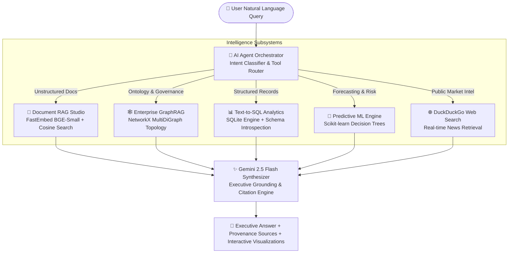

# ⚡ Enterprise Knowledge & Data Intelligence Assistant

[](https://www.python.org/)
[](https://streamlit.io/)
[](https://share.streamlit.io/)
[](https://ai.google.dev/)
[](https://github.com/qdrant/fastembed)
[](https://networkx.org/)
[](https://scikit-learn.org/)
[](https://www.sqlite.org/)
[]()
[]()

An end-to-end, multi-modal enterprise intelligence platform that unifies **Document RAG**, **GraphRAG Knowledge Networks**, **Text-to-SQL Analytics**, and **Machine Learning Predictive Modeling** into an autonomous AI Copilot.

---

## 📌 Executive Summary

Modern enterprises operate in fragmented data silos:
1. **Unstructured Knowledge:** Corporate policies, compliance charters, financial earnings reports, and customer SLAs locked in PDFs and text files.
2. **Structured Business Data:** Operational records, sales transactions, employee performance, and customer support tickets stored in relational databases.
3. **Complex Relational Ontologies:** Cross-departmental dependencies, compliance mandates (SOC 2, GDPR, FIDO2 MFA), and incident escalation chains.
4. **Forward-Looking Projections:** Demand forecasting and organizational risk scenarios requiring predictive machine learning models.

The **Enterprise Knowledge & Data Intelligence Assistant** bridges these domains into a single decision-support engine. Powered by **Google Gemini 2.5**, **FastEmbed**, **NetworkX**, **SQLite**, and **Scikit-learn**, it autonomously classifies user intent and synthesizes multi-source answers accompanied by verified citations, live database queries, and interactive visualizations.

---

## 🏗️ System Architecture



---

## 🚀 Key Capabilities & Modules

### 1. 💬 Unified AI Assistant (Omni-Chat)
- **Autonomous Intent Routing:** Analyzes incoming questions and dynamically routes execution across Vector RAG, GraphRAG, SQL, or ML models.
- **Explainable Tool Badging:** Displays which backend engine answered the question (`[SQL Analytics]`, `[Document RAG]`, `[GraphRAG]`, `[ML Prediction]`).
- **Rich Synthesis:** Returns grounded executive text, collapsible source citations with exact similarity confidence scores, live SQL dataframes, and knowledge graph relationship triples.

### 2. 📄 Document RAG Studio
- **Multi-Format Ingestion:** Ingests `.pdf`, `.docx`, `.txt`, `.csv`, and `.md` files.
- **Policy-Aware Chunking:** Parses document hierarchy preserving numbered headings (`1. REFUND POLICY`, `2. ACCESS CONTROL`) and paragraph semantics.
- **Local Dense Embeddings:** Employs `BAAI/bge-small-en-v1.5` via FastEmbed for CPU-efficient, high-accuracy semantic vector search.
- **Preloaded Enterprise Corpus:** Pre-configured with realistic corporate documents:
  - *Company Policy Document* (Refunds, customer support hours, remote work limits, annual leave).
  - *FY2025 Audited Q4 Financial Earnings* (ARR, product revenue, geographical growth, guidance).
  - *IT Security & SOC 2 Compliance Directive* (Zero-trust architecture, FIDO2 MFA, Sev 1–4 incident SLAs).
  - *Enterprise Product Catalog & SLA Guidelines* (99.95% uptime guarantees, service credit tiers).

### 3. 🕸️ Enterprise GraphRAG (Knowledge Graph)
- **Topological Ontology:** Models organizational entities across Departments, Policies, Products, Compliance Frameworks, and Incident Severity levels using `NetworkX`.
- **Neighborhood Subgraph Retrieval:** Traverses 1-hop and 2-hop entity relationships to provide contextual governance facts (e.g., *"What policies govern Engineering?"* or *"Who is alerted on a Sev-1 incident?"*).
- **Dependency Path Finder:** Computes shortest dependency chains between any two corporate concepts (e.g., from `Engineering` to `SOC 2 Type II`).
- **Interactive Visualization:** Renders 2D topological network graphs powered by Altair and Vega-Lite.

### 4. 📊 Structured Business Data & Text-to-SQL Analytics
- **Enterprise SQLite Relational Store:** Complete schema containing:
  - `employees`: 20+ records with salary, department, performance rating, remote work frequency, and retention risk.
  - `sales_transactions`: 20+ enterprise deals across products (CloudPlatform, EnterpriseAI, SecuritySuite, DataHub) and global regions.
  - `support_tickets`: Customer support tickets with priority levels, resolution times (hours), and CSAT scores (1–5).
  - `financial_metrics`: Multi-quarter financial performance (Revenue, OpEx, Net Income, Churn Rate).
- **Text-to-SQL Engine:** Automatically introspects database schema and compiles natural language questions into valid, read-only SQL queries with strict guardrails against destructive operations (`DROP`, `DELETE`, `ALTER`).
- **Interactive BI Dashboards:** Visualizations of revenue trajectories, regional sales distributions, and departmental salary spreads.

### 5. 🤖 Predictive Machine Learning Engine
- **Quarterly Revenue Forecaster:** Predicts expected quarterly revenue based on marketing spend, active sales headcount, customer CSAT, discount rates, and quarterly seasonality.
- **Employee Retention Risk Scorer:** Evaluates employee attrition probability based on salary, tenure, performance ratings, remote work days, and monthly overtime.
- **What-If Scenario Simulators:** Real-time parameter sliders allowing business leaders to simulate outcomes and view feature importance weights.

---

## 📂 Repository Structure

```text
Enterprise_Knowledge_Data_Intelligence_Assistant/
│
├── streamlit_app.py          # Root entrypoint for Streamlit Community Cloud
├── app/
│   └── streamlit_app.py      # Full-featured multi-tab Streamlit dashboard
├── .streamlit/
│   ├── config.toml           # Enterprise theme & server parameters
│   └── secrets.toml.example  # Secrets template
│
├── config/
│   └── (Configuration settings and defaults)
│
├── data/
│   ├── documents/                # Enterprise document knowledge base
│   │   ├── company_policy.txt
│   │   ├── q4_financial_earnings.txt
│   │   ├── it_security_compliance.txt
│   │   └── product_sla_guidelines.txt
│   ├── models/                   # Serialized ML model artifacts
│   └── enterprise.db             # Auto-generated enterprise SQLite database
│
├── src/
│   ├── __init__.py
│   ├── agent/
│   │   ├── __init__.py
│   │   └── orchestrator.py       # Central AI agent, query classifier & tool router
│   ├── analytics/
│   │   ├── __init__.py
│   │   └── visualizer.py         # Altair charts & KPI calculation utilities
│   ├── config/
│   │   ├── __init__.py
│   │   └── settings.py           # Paths, thresholds, model settings & secret loaders
│   ├── database/
│   │   ├── __init__.py
│   │   └── enterprise_db.py      # SQLite connection manager, schema builder & seed data
│   ├── graph/
│   │   ├── __init__.py
│   │   └── knowledge_graph.py    # NetworkX ontology, GraphRAG search & path finder
│   ├── ingestion/
│   │   ├── __init__.py
│   │   └── document_manager.py   # Multi-format document loader & policy chunker
│   ├── models/
│   │   ├── __init__.py
│   │   └── ml_engine.py          # Scikit-learn revenue & employee retention models
│   └── retrieval/
│       ├── __init__.py
│       └── vector_store.py       # FastEmbed semantic indexing & cosine retrieval
│
├── tests/
│   ├── test_agent.py             # Agent routing & intent classification tests
│   ├── test_database.py          # SQLite schema, queries & security guardrail tests
│   ├── test_graph.py             # GraphRAG metrics, subgraphs & path finding tests
│   ├── test_ingestion.py         # Multi-document loading & chunking tests
│   ├── test_ml_models.py         # Revenue forecaster & retention classifier tests
│   └── test_retrieval.py         # Vector similarity search & citation tests
│
├── .gitignore
├── requirements.txt              # Production dependency specifications
└── README.md                     # Comprehensive documentation
```

---

## ⚙️ Quickstart & Local Installation

### Prerequisites
- Python 3.10 to 3.13
- A Google Gemini API Key ([Get a free key from Google AI Studio](https://aistudio.google.com/))

### 1. Clone the Repository
```bash
git clone https://github.com/charmithareddy/Enterprise-Knowledge-Data-Intelligence-Assistant.git
cd Enterprise-Knowledge-Data-Intelligence-Assistant
```

### 2. Set Up Virtual Environment
```bash
python -m venv .venv

# On Windows:
.venv\Scripts\activate

# On macOS/Linux:
source .venv/bin/activate
```

### 3. Install Dependencies
```bash
pip install -r requirements.txt
```

### 4. Configure Gemini API Key
Create a `.env` file in the project root:
```env
GEMINI_API_KEY="your-gemini-api-key-here"
```
*Or create `.streamlit/secrets.toml`:*
```toml
GEMINI_API_KEY = "your-gemini-api-key-here"
```
*(Note: If no API key is provided, the platform automatically runs in deterministic local mode with full access to SQL data, Graph traversal, Vector citations, and ML predictions!)*

### 5. Launch the Application Locally
```bash
streamlit run streamlit_app.py
```
The application will open in your browser at `http://localhost:8501`.

---

## 🌐 Deploy as a Live Website (Streamlit Community Cloud)

You can deploy this repository as a publicly accessible live website for free on **Streamlit Community Cloud**:

1. **Fork or Push to GitHub:** Ensure your latest commits are on your GitHub repository:
   `https://github.com/charmithareddy/Enterprise-Knowledge-Data-Intelligence-Assistant`
2. **Sign in to Streamlit:** Go to [share.streamlit.io](https://share.streamlit.io/) and connect your GitHub account.
3. **Create New App:**
   - **Repository:** `charmithareddy/Enterprise-Knowledge-Data-Intelligence-Assistant`
   - **Branch:** `main`
   - **Main file path:** `streamlit_app.py`
4. **Configure Secrets:**
   - Click **Advanced settings...**
   - In the **Secrets** box, paste:
     ```toml
     GEMINI_API_KEY = "your-actual-gemini-api-key"
     ```
5. **Click Deploy!**
   - Streamlit Cloud will automatically build dependencies from `requirements.txt` and launch your live web assistant with a permanent public URL (e.g., `https://enterprise-knowledge-assistant.streamlit.app`).

---

## 🧪 Automated Testing Suite

The repository includes a comprehensive unit and integration test suite covering all modules:

```bash
python -m unittest discover -s tests -p "test_*.py"
```

### Test Coverage Highlights:
- **`test_database.py`**: Validates table schemas, seed data integrity, and read-only query guardrails.
- **`test_graph.py`**: Verifies graph initialization, degree metrics, subgraph traversals, and shortest path logic.
- **`test_ml_models.py`**: Confirms predictive outputs, confidence intervals, and probability distributions.
- **`test_ingestion.py`**: Asserts multi-format text loading and policy-aware heading chunking.
- **`test_retrieval.py`**: Validates FastEmbed embeddings and semantic similarity rankings against real policy queries.
- **`test_agent.py`**: Tests autonomous query classification and tool coordination.

---

## 💡 Example Prompt Scenarios

| User Prompt | Identified Intent | Activated Tool | Output Produced |
|:---|:---|:---|:---|
| *"What is our refund policy and SLA for critical customer issues?"* | `DOCUMENT_RAG` | Vector Store (`FastEmbed`) + Gemini | Grounded summary with exact policy section citations and similarity scores. |
| *"Show total revenue by region and top 5 sales deals"* | `SQL_ANALYTICS` | Text-to-SQL + SQLite | Executed SQL query, formatted results table, and revenue metrics. |
| *"What policies govern remote work and zero-trust security for engineering?"* | `GRAPH_RAG` | Knowledge Graph (`NetworkX`) | Relational link breakdown across `Engineering`, `Remote Work Policy`, and `FIDO2 MFA`. |
| *"Predict Q2 sales revenue if marketing spend increases to $5.5M"* | `ML_PREDICTION` | ML Forecaster (`Scikit-Learn`) | Forecasted revenue ($M), 95% confidence bounds, and driver importance chart. |
| *"Which employees have high retention risk and what are their salaries?"* | `SQL_ANALYTICS` | SQLite Engine | Filtered tabular records of high-risk personnel and department distributions. |

---

## 🛡️ Enterprise Security & Design Safeguards

- **Read-Only Database Sandbox:** The SQL executor inspects queries prior to execution, rejecting any destructive statements (`DROP`, `DELETE`, `UPDATE`, `INSERT`, `ALTER`, `TRUNCATE`).
- **Grounded Hallucination Guard:** When answering company-specific questions, the agent cross-references retrieved vector passages; if no factual basis exists, it explicitly informs the user rather than hallucinating policies.
- **Credential Protection:** Secrets and environment files (`.env`, `secrets.toml`, `*.db`) are strictly excluded in `.gitignore` to prevent credential leakage.

---

## 👤 Author & Attribution

Developed by **Charmitha Reddy**  
- **GitHub:** [@charmithareddy](https://github.com/charmithareddy)  
- **Project Repository:** [Enterprise-Knowledge-Data-Intelligence-Assistant](https://github.com/charmithareddy/Enterprise-Knowledge-Data-Intelligence-Assistant)  
- **License:** Open Source under the MIT License
